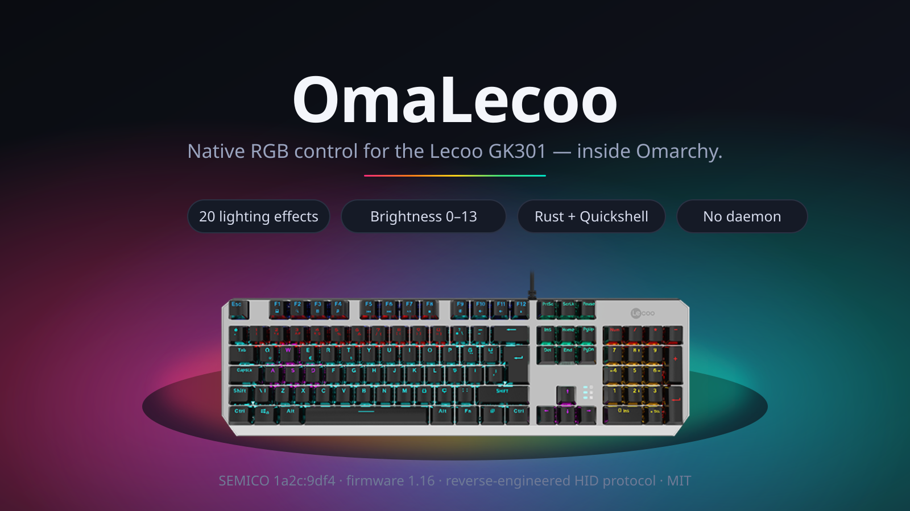
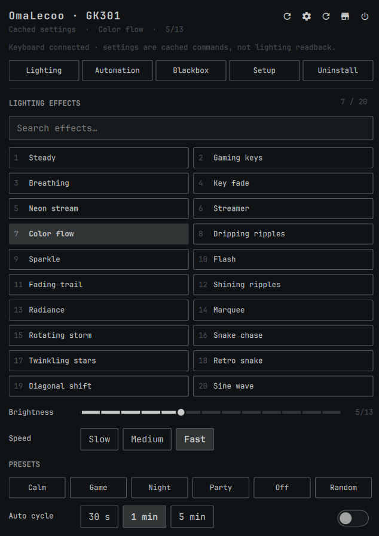

<div align="center">



# OmaLecoo

Native lighting control and an event-aware automation service for the Lecoo
GK301, built with Rust and Quickshell for SEMICO `1a2c:9df4`.

[Setup](#setup) · [What it touches](#what-this-plugin-touches) · [CLI](#cli)

</div>

> Omarchy plugin: bar widget, control panel, CLI controller and automation
> rules for the GK301's backlight.

```bash
omarchy plugin add https://github.com/OnurByte/OmaLecoo.git --enable
```

The repository root is the plugin folder. `omarchy plugin add` clones it, and
the first load completes the setup: the controller builds from the checkout,
and the udev rule installs through one polkit prompt. The sections below
describe every step and how to undo them.

| Signal Engine | HID Blackbox | Ghost Mode |
| --- | --- | --- |
| Opt-in fullscreen and idle rules, with the active reason shown in the panel. | UTC time, command origin, report bytes and syscall outcome, stored locally. | Muted cached settings while disconnected, with optional one-time recovery on reconnect. |

| Macros | Function keys |
| --- | --- |
| Timed lighting sequences you build in the panel and play on the keyboard. | The GK301's function and media keys, with the commands Hyprland runs for them. |

No daemon. No second Quickshell process. No network calls. The panel and the
CLI talk to the keyboard through one small Rust controller that serializes
every write behind a single lock.

---

## Why this exists

The GK301 ships with a Windows-only utility. Its lighting protocol was never
documented, so OmaLecoo recovered it: static disassembly of the official
tool, a usbmon capture of real traffic, and confirmation on the physical
keyboard. The write-up lives in [`docs/`](docs/FINAL-ANALYSIS.md).

The lighting protocol comes from reverse engineering the official Windows
controller, matching USB control captures, and asking the user what the
physical LEDs actually did. The v1.5 service builds on those existing
commands. Its fullscreen and restore rules were confirmed on a live Omarchy
session on 20 October 2026; the idle rule and reconnect recovery still need
live validation. See the [verification record](docs/verification.md) for the
checks performed so far.

## Setup

Install and enable the plugin:

```bash
omarchy plugin add https://github.com/OnurByte/OmaLecoo.git --enable
```

The first load completes setup by itself:

1. **Native controller.** The plugin checks for `~/.local/bin/lecoo-gk301`.
   When it is missing, the panel builds the controller from the checkout the
   clone command just placed on disk, with `omarchy pkg add rust` run first if
   Cargo is absent. Cargo may fetch `serde_json` from crates.io while it
   builds; the plugin itself makes no network calls.
2. **Device access.** While the keyboard is connected but read-only, the panel
   raises one polkit prompt that installs the GK301 udev rule.

The **Setup** page keeps every step as a button and shows the current setup
message. The controller build writes compile artifacts under
`~/.cache/lecoo-gk301`; `~/.local/bin` and `~/.config` are not used for
artifacts.

The source installation equivalent is:

```bash
cargo install --path "$HOME/.config/omarchy/plugins/borat.lecoo-rgb" \
  --root "$HOME/.local" --locked --target-dir "$HOME/.cache/lecoo-gk301"
```

It installs crate `omalecoo` as **`~/.local/bin/lecoo-gk301`**, the panel's
default controller path. A custom path can be set in the widget's `binary`
setting; installing into `~/.local` does not replace that setting.

Device authorization runs the equivalent of:

```bash
pkexec "$HOME/.local/bin/lecoo-gk301" udev install
```

The controller manages only `/etc/udev/rules.d/70-lecoo-gk301.rules`, matching
vendor `1a2c`, product `9df4`, interface `01` with `uaccess`, then reloads and
triggers udev. It refuses to overwrite a rule whose contents differ. Routine
lighting controls run as your user after authorization.

Installation follows the repository's default branch. This checkout
identifies itself as v1.5.0 development; these notes do not announce a
published v1.5 release or promise a v1.5 release asset.

## What this plugin touches

Everything OmaLecoo does outside your home directory, in one table. Nothing
else is written, and no other plugin's configuration is modified.

| Path | When | What it is |
| --- | --- | --- |
| `/etc/udev/rules.d/70-lecoo-gk301.rules` | Only in the polkit-authorized step | One udev rule granting your session access to the GK301 hidraw node. Exact-content checked: it is never overwritten with different content, and removal only deletes a file with the exact content it owns. |
| `~/.local/bin/lecoo-gk301` | When you install the controller from source | The Rust controller. `cargo install --root "$HOME/.local"`, or any other path you choose. |
| `~/.local/state/lecoo-gk301/` | While the plugin is used | `state.json` (your manual restore point), `rules.json` (automation settings), `macros.json` and `keys.json` (your macros and key commands), `hypr-binds.lua` (the generated Hyprland fragment), `blackbox.jsonl` (command history), `debug.log` and `command.lock`. |
| `~/.cache/lecoo-gk301/` | During a source build | Cargo compile artifacts. Safe to delete; the next build recreates it. |

- **Privileged action:** exactly one — the polkit step that writes the udev
  rule. It is invoked as `pkexec <controller> udev install` with a fixed
  argument list, and the controller refuses to run unless it is root. If
  Cargo is missing, the setup's first step is `omarchy pkg add rust`, which
  uses Omarchy's own package command and its own approval prompt.
- **Network:** none at runtime. The source build may fetch the crate
  registry, and nothing else calls out.
- **Input:** the controller only writes HID feature reports to the keyboard.
  It never opens the keyboard's input stream and never records typed keys.
- **Other plugins:** untouched. Omarchy's own plugin and bar settings are
  read, never written.

## Automation (Signal Engine)

**Signal Engine** runs inside Omarchy's existing Quickshell process. There is
no separate Rust daemon. Enable it on the **Automation** page; automation and
reconnect recovery both default to off, including when rules are malformed.

| Priority | Condition | Command |
| --- | --- | --- |
| 1 | A manual panel/bar action | Pause automation for 30 minutes |
| 2 | Idle for five minutes; idle inhibitors respected | `preset off` |
| 3 | The active window is fullscreen | `preset game` |
| 4 | Otherwise | `restore` the saved manual settings |

Automatic changes preserve the manual restore point. Events are coalesced for
250 ms, and the service waits at least two seconds after a command finishes
before sending another HID command. Rust keeps its shared process lock and
110 ms protocol pacing for all writers. Lock-screen automation is deferred
until a stable public Omarchy lock-state signal is available.

**Ghost Mode** checks presence and writability every ten seconds without
sending HID reports. Disconnection shows a muted last-known state; permission
denied and a missing controller get their own messages. Enable **Restore
settings once after reconnect** for one `restore --origin signal` after a
reconnect. The service suppresses writes while the device is absent or denied.

Automation and service-driven recovery require **Omarchy's built-in bar**.
The service only sends automatic or recovery commands while a built-in bar
widget is attached; removing the last widget cancels pending recovery.
Replacement bars can retain manual controls, but do not provide this service
integration.

## Macros: lighting sequences

A macro is a named, timed sequence of lighting states. Build one in the
**Macros** page: press **Add current lighting** to append the effect,
brightness and speed that are on screen right now, set the delay before the
step, and save it under a name. **Play** sends the whole sequence to the
keyboard; **Remove** deletes it.

The original Windows tool recorded key sequences and replayed them on the
Windows host with `keybd_event`. On Linux the compositor owns keyboard input,
so OmaLecoo's macros move the lights instead — the device-side sequence the
hardware can actually perform. Every step is an ordinary panel command, so
macros obey the same lock, pacing and Blackbox records as everything else.

```bash
lecoo-gk301 macro list --json
lecoo-gk301 macro save --name boot --steps '[{"delay_ms":0,"effect":0,"brightness":8,"speed":2,"select":0}]'
lecoo-gk301 macro play boot
lecoo-gk301 macro export ~/macros.json
lecoo-gk301 macro import ~/macros.json
```

## Function keys

The **Keys** page lists the GK301's function and media keys with the names and
codes the original Windows tool used in its `config.xml`. Each key gets the
command Hyprland should run; an empty field leaves the key alone. **Write
Hyprland fragment** writes the result to
`~/.local/state/lecoo-gk301/hypr-binds.lua` and prints the line to add to
your own Hyprland config:

```lua
dofile(os.getenv("HOME") .. "/.local/state/lecoo-gk301/hypr-binds.lua")
```

Omarchy already binds the volume and media keys, so including the fragment
takes them over. Delete a line to keep Omarchy's own binding.

```bash
lecoo-gk301 keys list --json
lecoo-gk301 keys set "Calculator" --command "omacalc"
lecoo-gk301 keys export
```

## Gaming zones

The GK301 keeps ten lighting layouts in its own controller and its
**FN+1 … FN+0** keys pick one: FPS 1, FPS 2, COD, RTS, LOL, Racing, NBA,
LOL II, Custom I and Custom II. Pressing FN+1 lights ESC, WASD and the
arrow keys; FN+2 lights TAB, SHIFT, CTRL, QWER, HOME, PRTSC, SCRLK, PGUP,
END and PGDN.

**The host cannot choose a zone.** The recovered report has no field for it,
no command for one has been found, and the keyboard keeps the chosen zone
across host commands. The host cannot even *see* the zone: a 100-second
recording of the keyboard's vendor interface produced no input reports at
all, so there is no report that carries the current selection. What the
plugin can do is re-apply the **Gaming Special Key** effect — that is what
the **Game** preset and the fullscreen rule do — and the keyboard then lights
whichever zone its own FN key last selected.

The **loader byte** carries the Windows tool's M1, M2 and M3 values. On this
unit the firmware lights the special-key group only for the third value: the
first two leave the board dark at every tested brightness and combination,
and the Windows tool sends the same values and darkens the same way. The
panel therefore applies M3 for the Gaming Special Key effect and keeps no
loader control of its own.

```bash
lecoo-gk301 zones list          # the ten hardware layouts
lecoo-gk301 zones list --json
```

## Command log (HID Blackbox)

**HID Blackbox** records OmaLecoo's vendor-HID exchanges with UTC timestamps,
origin (`panel`, `signal`, or `cli`), report bytes, syscall return/error, and a
short outcome. The panel shows the newest 40 entries; `blackbox --json` reads
the retained history, newest first, skipping malformed JSON entries.

The current `blackbox.jsonl` rotates at 1 MiB and retains one previous file,
`blackbox.jsonl.1`. Recording is best-effort: a log failure does not turn a
successful device command into a failure. A successful transfer records the
syscall result; it does not establish that the LEDs visibly changed.

Settings, rules, Blackbox history and the debug log stay under
`$XDG_STATE_HOME/lecoo-gk301`, or `~/.local/state/lecoo-gk301` by default.
The recorder does not open the keyboard input stream or record typed keys.
Firmware replies are labeled **acknowledgements**, and cached lighting values
are labeled **cached settings**. The firmware query is not lighting readback.

## What the hardware evidence supports

The tested GK301 reports firmware **1.16**. Software automation adds ways to
schedule the existing packets; it does not add new keyboard capabilities.

| Capability | Evidence and boundary |
| --- | --- |
| Main lighting effects | 20 recovered effect choices; main-effect changes confirmed on the physical keyboard. [Protocol and captures](docs/FINAL-ANALYSIS.md), [user observations](docs/physical-validation.md). |
| Brightness 0–13 for general effects | Windows UI clamps to 5; its stored record carries 13. The user confirmed a visible difference between 5 and 13 for the Steady effect. [Experiment](docs/captures/extended-brightness-experiment.md). |
| Gaming Special Key envelope | Verified on this unit at brightness 0–5 (2, 3, 4 and 5 lit with visible difference) at speed 2 with the third loader value; brightness 8, 9 and 13 render no light on this path. [Capture and sweeps](docs/captures/lighting-zone-capture.md). |
| Speed 0–2 | Recovered main-panel mapping; speed applies to effects 2–19 and the gaming page fixes it at 2 like the Windows tool. [Analysis](docs/FINAL-ANALYSIS.md). |
| Presets, rotation, restore | Software compositions of the existing main-panel command. No extra packet family or on-device preset storage is claimed. |
| Loader byte (M1/M2/M3) | The tool's stored 1/2/3 map to wire 0/1/2. On this unit only wire value 2 lights the special-key group; 0 and 1 leave it dark, and values above 2 blink and fall back. [Capture](docs/captures/lighting-zone-capture.md). |
| Factory defaults | `restore --factory` applies the same default record the Windows tool starts with, and makes it the new manual state. |
| Signal Engine, Blackbox, Ghost Mode | Implemented software features; static/build checks and live-validation limits are listed in [verification](docs/verification.md). |
| Firmware response | Validated F1 reply contains firmware data. The tested GET path does not report current lighting. [Readback experiment](docs/FINAL-ANALYSIS.md#new-readback-experiment). |
| Side RGB | Excluded: the recovered writer belongs to a hidden Mouse page and caused no visible change on this keyboard. [Failure analysis](docs/side-failure-analysis.md). |
| Custom colors / per-key RGB | No arbitrary RGB triplet or per-key sender established. [Color investigation](docs/custom-color-investigation.md). |
| On-device macros | Not implemented: the recovered macro worker plays keys on the Windows host. [Analysis](docs/FINAL-ANALYSIS.md#excluded-capabilities). |

### Compared with the original Windows tool

The full inventory is in [Windows app ↔ OmaLecoo feature parity](docs/windows-app-parity.md).
The three differences that were open are now handled:

- **Settings → Restore** has an equivalent: `restore --factory`, also on the
  panel.
- **The macro editor** exists as lighting macros. The original recorded key
  sequences and replayed them on the Windows host; on Linux the compositor
  owns keyboard input, so the macros here are device-side lighting sequences.
- **The function-key configuration** exists as the GK301 key map plus a
  generated Hyprland fragment, which is how a Linux desktop programs keys.

OmaLecoo avoids per-effect pages with hidden fields: one uniform record, the
extended brightness scale, the special-key lighting at its verified envelope,
and desktop-aware rules, a local command log, and an Omarchy-native panel
that the Windows app does not provide.

### Eight bytes to the keyboard

Vendor HID **interface 1**, **Feature report ID 7**, eight bytes including ID:

```text
byte       0   1   2   3   4   5   6   7
panel     07  FF  FF  ee  bb  ss  kk  00
query     07  F1  00  00  00  00  00  00
reply     07  01  16  00  00  00  00  00

ee = effect 0–19    bb = brightness (general 0–13, gaming lights 0–5)
ss = speed 0–2      kk = loader 0–2 (this unit lights the third value)
Observed firmware reply: 1.16
```

The F1 request is SET_FEATURE followed by GET_FEATURE. Repeating GET after a
lighting command returned the same firmware reply on the tested unit. This
bounds the claim to that query path; it does not prove no other query exists.

## Panel and bar

With this plugin checkout loaded in the built-in bar, left-click its keyboard
icon. **Lighting → Automation → Macros → Keys → Blackbox → Setup → Uninstall**
are the seven panel pages. Open Lighting for the searchable effect grid,
brightness, speed, presets and auto cycle; open Automation for the current
rule and its reason; Macros builds lighting sequences; Keys maps the function
keys; Blackbox provides the command history behind the controls.

Right-click the bar icon for the next effect; scroll for brightness. Panel
shortcuts: `n` / `p` next/previous, `o` off, `r` refresh, `Esc` close.



That is the real panel, captured from a live Omarchy session on 20 October
2026 with the keyboard connected. The header shows the device, the selected
effect and the brightness; the seven buttons are the panel pages. The banner
at the top of this page is a project image, not a screenshot.

Hardware appearance still requires looking at the connected keyboard.

## CLI

The installed binary keeps the name `lecoo-gk301`. A controller at a custom
path can be invoked directly; otherwise use `~/.local/bin/lecoo-gk301` if that
directory is not on your `PATH`.

```bash
# Local metadata and history; no HID report is sent
lecoo-gk301 --help
lecoo-gk301 dev --json
lecoo-gk301 status --json           # saved manual restore point, not live LED state
lecoo-gk301 capabilities --json
lecoo-gk301 catalog --json
lecoo-gk301 list
lecoo-gk301 rules --json
lecoo-gk301 blackbox --json

# Write both automation settings; enabling the rules requires the QML service
lecoo-gk301 rules set --automation on --restore-on-reconnect off

# Lighting commands; these change the keyboard
lecoo-gk301 panel 2 --brightness 5 --speed 1 --select 0
lecoo-gk301 brightness 8
lecoo-gk301 next
lecoo-gk301 prev
lecoo-gk301 preset night            # silent | game | night | party | off | random
lecoo-gk301 restore                 # reapply the saved manual settings
lecoo-gk301 restore --factory       # apply the Windows tool's default lighting record

# Macros: timed lighting sequences
lecoo-gk301 macro list --json
lecoo-gk301 macro play <name>

# Function keys: the GK301 key map and the Hyprland fragment
lecoo-gk301 keys list --json
lecoo-gk301 keys export

# Diagnostics that access vendor HID
lecoo-gk301 doctor
lecoo-gk301 response --json         # validated firmware response and timing
lecoo-gk301 info --json             # firmware bytes/version
lecoo-gk301 get                     # GET_FEATURE; not lighting state
```

HID commands accept `--device /dev/hidrawN` or `LECOO_DEVICE` to override
detection. `dev --json` always describes automatic discovery. HID commands
also accept `--origin panel` or `--origin signal`; omitting the option records
`cli`. Signal-origin lighting writes preserve the saved manual state. A
30-minute manual pause is coordinated by the panel/bar service; direct CLI
commands do not initiate that pause.

The narrow maintenance commands are `lecoo-gk301 state clear` and
`lecoo-gk301 udev install` / `lecoo-gk301 udev remove` (the latter require root,
normally through the panel's polkit action). `side`, `raw` and `reset` are not
product commands. The hidden `probe-brightness` and `probe-startup`
diagnostics remain research tools; historical documents may describe retired
probes and controls.

## Uninstall

Open **Uninstall**, choose the items, select **Review selected removal…**,
then **Confirm removal**.

| Choice | Action |
| --- | --- |
| Plugin checkout (selected by default) | Starts detached `omarchy plugin remove borat.lecoo-rgb --yes` after the selected cleanup finishes. |
| Controller under `~/.local` | Runs `cargo uninstall --root "$HOME/.local" omalecoo`; requires Cargo and the managed controller path. Custom configured binary paths are left for their original installation method. |
| GK301 udev rule (optional) | Runs `pkexec <configured-controller> udev remove`; removes only the exact owned rule and reloads/triggers udev. |
| Settings and diagnostic logs (optional) | Runs `<configured-controller> state clear` before removing the controller. Deletes `state.json`, `rules.json`, both Blackbox files and both debug logs. |

State and device access are preserved unless selected. Cleanup stops on a
failure before proceeding to later steps. State cleanup leaves `command.lock`,
backups and unrelated files in the state directory. Removing saved settings
does not reset the physical keyboard's lighting.

A controller installed outside `~/.local` — for example `cargo install` into
`~/.cargo/bin`, or a manually placed binary — is not touched by the panel's
uninstall, because the plugin cannot prove that such a file belongs to it.
Remove those with the method you installed them with.

## Documentation

- [Final protocol and readback conclusions](docs/FINAL-ANALYSIS.md)
- [Physical user observations](docs/physical-validation.md)
- [Extended brightness: recovered code, packets and observation](docs/captures/extended-brightness-experiment.md)
- [USB captures and live analysis](docs/captures/live-analysis.md) · [final readback capture](docs/captures/final-readback-control.pcapng) · [direct ioctl observations](docs/captures/final-readback-probe.json)
- [REA findings](docs/rea-findings.md) · [HID descriptors](docs/hid-descriptors.json)
- [Why arbitrary color is unproven](docs/custom-color-investigation.md)
- [Windows app ↔ OmaLecoo feature parity](docs/windows-app-parity.md)
- [Development checks and historical release notes](docs/verification.md)

The project began with a Windows-only GK301 utility that would not run in my
Omarchy setup. REA disassembly, exported UI definitions, USB captures and user
observations supplied the pieces for a native controller. The evidence records
explain which pieces held up and which controls were removed.

The plugin is Rust and Quickshell only. `src/` holds the controller as a
library plus the `lecoo-gk301` binary: `protocol` and `transport` own the
wire format, `device` owns discovery and writes, `state` and `blackbox` own
persistence, `macros` and `keys` own the macro and function-key models,
`lock` serializes every writer, and `udev` owns the single rule.
`SignalService.qml` owns desktop events and arbitration; `BarWidget.qml` and
`Panel.qml` provide the native UI. `manifest.json` registers the service and
bar widget at the repo root. Original vendor binaries remain local, outside
version control.

## License

[MIT](LICENSE)
